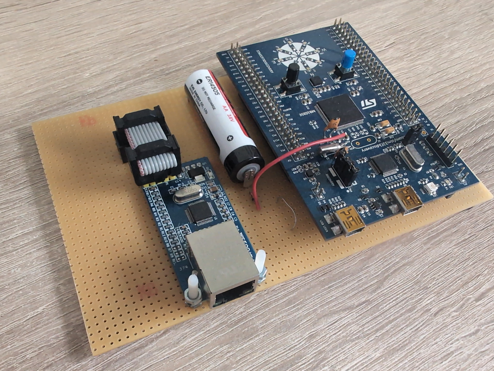
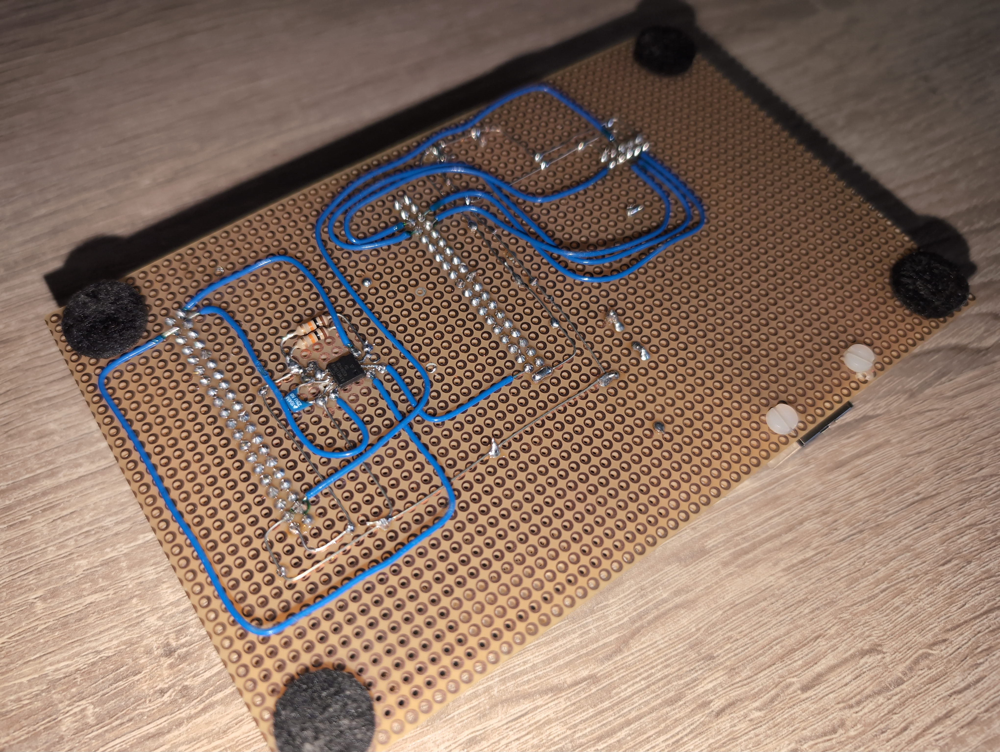
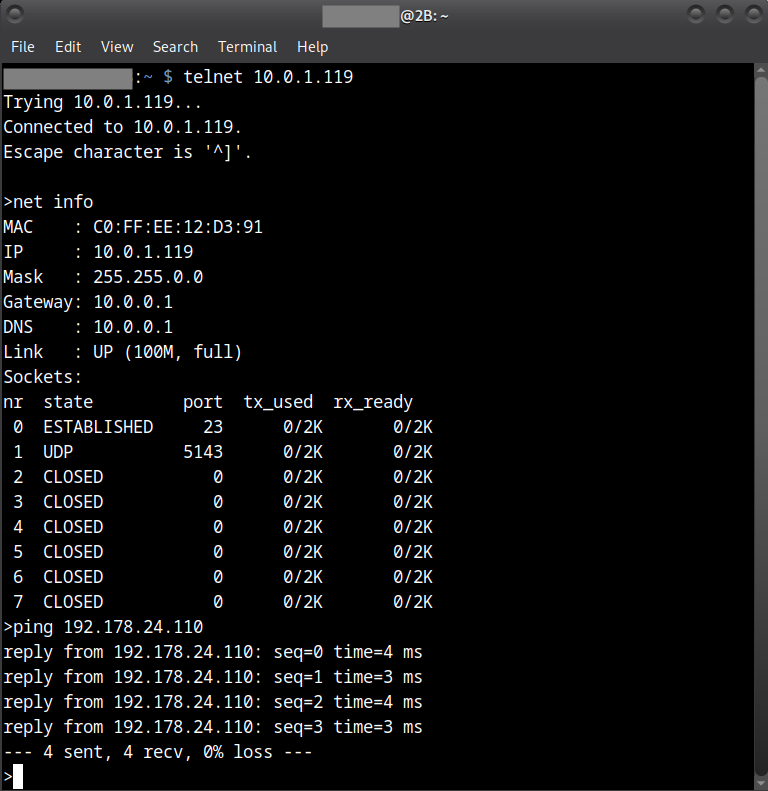
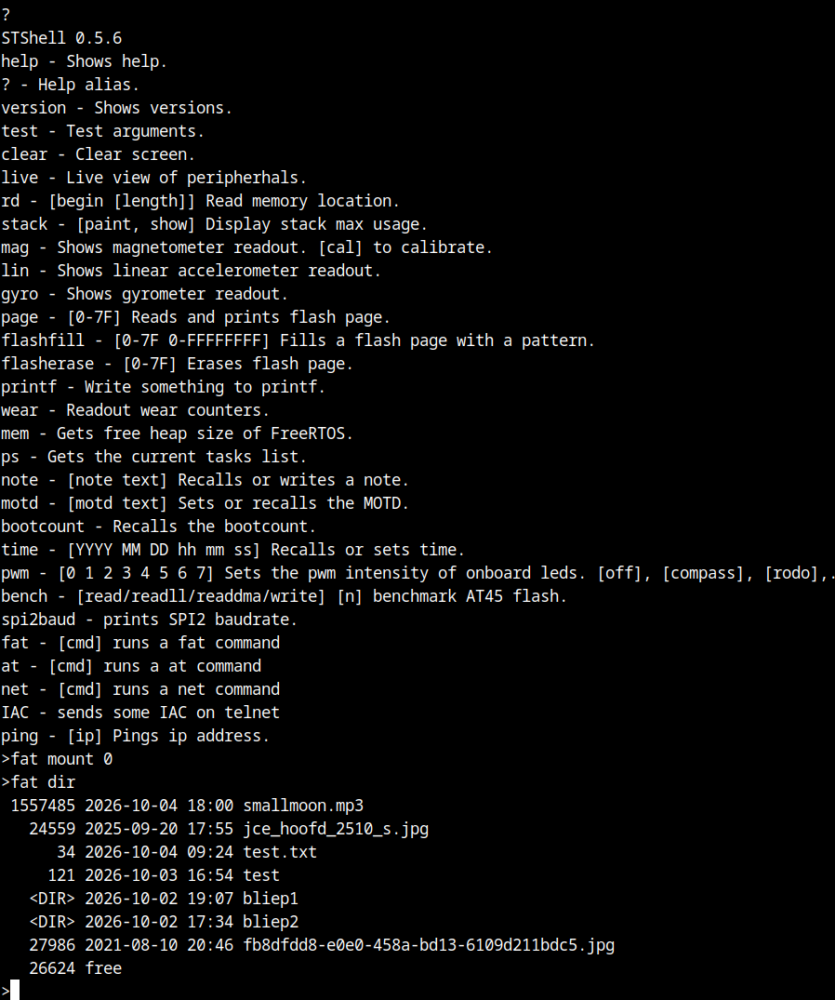

# STShell

An interactive shell and embedded playground for the STM32F303VCT. STShell started as a flash-filesystem experiment and grew into a networked target: the shell runs over UART (via the onboard ST-LINK virtual COM port) and over **telnet** through a WIZnet W5500 Ethernet chip.

> This is a personal learning project. It is not a library or product.




## Features

- Interactive shell on USART1, routed through the ST-LINK VCP, **and served over telnet** (W5500)
- Line editor with insert and delete at cursor
- W5500 Ethernet with network diagnostics: `net info`, socket states, `ping`
- **ICMP ping implemented from scratch on the W5500's IPRAW mode** — see below
- Flash-backed USB Mass Storage — currently 2 MB DataFlash (AT45DB161B) presented as a FAT volume
- FAT filesystem inspection from the shell (`fat dir`)
- Flash wear metering: per-page erase counters, including erases performed by the host PC
- First-boot detection via a linker-placed flag page; firmware re-flashes are fed into the wear counters
- LSM303AGR magnetometer/accelerometer readout via interrupt-driven I2C at 10 Hz
- Stack high-water measurement (paint and inspect)
- Runtime diagnostics: `mem`, `ps`, `stack`, `bootcount`, `bench`

## Shell commands

```
help       Shows help.
?          Help alias. (screenshot)
version    Shows versions.
clear      Clear screen.
live       Live view of peripherals.
rd         [begin [length]] Read memory location.
stack      [paint, show] display stack max usage.
mag        Shows magnetometer readout.
lin/gyro   Shows accelerometer/gyro readout.
page       [0-7F] Reads and prints flash page.
flashfill  [0-7F 0-FFFFFFFF] Fills a flash page with a pattern.
flasherase [0-7F] Erases flash page.
printf     Write something to printf.
wear       Readout wear counters.
mem        Memory usage.
ps         Task/process list.
time       Set/show time.
bootcount  Boot counter.
note       Short notes (persistent).
mtd        MTD info.
pwm        PWM control.
bench      Speed benchmark.
spi2baud   Set SPI baud rate.
at         Manipulate dataflash.
fat        FAT filesystem commands (dir).
net        Network configuration.
ping       ICMP echo request.
```

*(The authoritative list is whatever `help` prints on your target — the set evolves.)*

## Screenshots

Shell over telnet, with `net info` and a `ping` to the outside world:



The command set, and a FAT directory listing straight from the target:



## Ping on the W5500: closing the ioLibrary gap

The stock WIZnet ioLibrary does not support ping. There is no `setPROTO()` function and no `Sn_PROTO` register macro in `w5500.h`, so the IPRAW socket is programmed via the socket register block directly:

```c
#define Sn_PROTO(N) (_W5500_IO_BASE_ + (0x0014 << 8) + (WIZCHIP_SREG_BLOCK(N) << 3))
WIZCHIP_WRITE(Sn_PROTO(PING_SOCK), IPPROTO_ICMP);
```

The WIZnet application note *"How to implement IPRAW"* (v1.1) provides the socket flow but is fragmentary: no checksum implementation, no timeouts, bare busy-waits. The working `ping` is built on its flow, hardened with an RFC 1071 ICMP checksum, proper reply matching (type, ID and sequence), and timeouts.

## Flash wear metering

Internal flash supports a limited number of erase cycles per page, and a flash-backed filesystem creates a skewed distribution: the FAT pages erase far more often than cold data. The `wear` command dumps per-page erase counts so this can be measured rather than assumed.

The counters are stored entirely in flash — each erase is tallied as halfwords in a reserved page, with automatic consolidation when a channel fills.

## Project layout

- `Core/` — application code: shell, command table, flash counters, first-boot flag
- `Drivers/` — HAL plus the LSM303AGR readout chain
- `Middlewares/ST/STM32_USB_Device_Library/`, `USB_DEVICE/` — USB MSC stack
- `docs/` — datasheets and pictures
- `STM32F303VCTX_FLASH.ld` — linker script, including the reserved wear-counter and first-boot pages

## Building

Built with STM32CubeIDE and STM32CubeMX (`blink_led_2.ioc`). Import the project into CubeIDE 2.2.0 and build; flash via the ST-LINK debugger.
